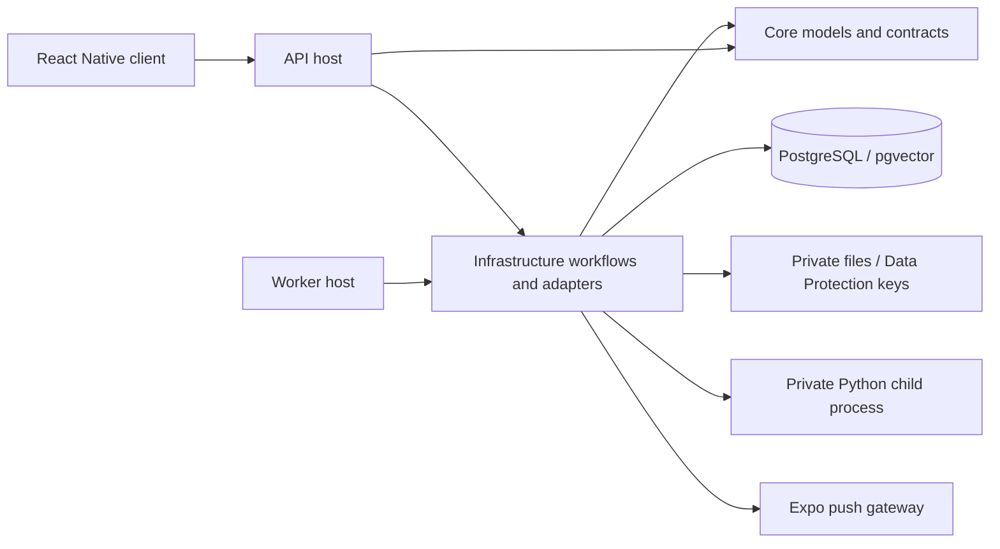

# Backend architecture and review guide

Uni Companion is a .NET 10 modular monolith with two hosts: an HTTP API and a background worker. PostgreSQL owns durable state; a private Python child process handles embeddings and generation. The goal is a small system whose behavior under retries, crashes and account changes can be explained and tested.

## A five-minute code tour

1. [API composition](src/UniCompanion.Api/Program.cs): registration, middleware order and feature endpoints. [Worker composition](src/UniCompanion.Worker/Program.cs): four independent hosted services.
2. [Core contracts](src/UniCompanion.Core/Study/StudyJob.cs): durable state, artifacts and external capability interfaces. Core has no ASP.NET Core or EF dependency.
3. [Study processor](src/UniCompanion.Infrastructure/Study/StudyProcessor.cs): claim → work → fenced publication, heartbeat, cancellation and transactional activity events.
4. [Push processor](src/UniCompanion.Infrastructure/Push/PushProcessor.cs): delivery leases, live account/device checks, tickets/receipts and atomic token invalidation.
5. [Integration tests](tests/UniCompanion.IntegrationTests/StudyTests.cs), [push recovery tests](tests/UniCompanion.IntegrationTests/PushTests.cs) and [worker lifecycle tests](tests/UniCompanion.UnitTests/WorkerLifecycleTests.cs): the failure proofs behind those claims.

## Dependencies and responsibilities



| Project | Responsibility | Boundary |
| --- | --- | --- |
| Core | Models, state contracts and capability interfaces | Framework-independent; no EF, HTTP host or adapters |
| Infrastructure | Workflows, EF persistence, identity, retrieval, subprocess and push adapters | Depends on Core; never on either host |
| API | Authentication/authorization at the edge, request validation, public DTOs and HTTP behavior | Feature folders; never referenced by the worker |
| Worker | Hosting, per-iteration scopes, cancellation and polling cadence | Delegates durable work to Infrastructure processors |
| UnitTests | Worker lifecycle and dependency guards | No database, model download or provider call |
| IntegrationTests | Requests, transactions, migrations, leases and isolation | Disposable real PostgreSQL databases; fake external providers |

Infrastructure intentionally contains both application workflows and technical adapters. Some endpoints use DbContext directly for small queries and writes. This is a pragmatic dependency structure, not a claim of strict Clean Architecture. Feature services carry workflows shared by the HTTP and worker hosts. A repository wrapper or mediator library would not remove the need to understand these transaction boundaries.

## Follow a study request

1. An authenticated student submits a bounded request and an idempotency key. The server verifies course access, validates scope and applies account/global admission limits.
2. [StudyJobs](src/UniCompanion.Infrastructure/Study/StudyJobs.cs) records the request and immutable source version IDs. Replaying the same key returns the same operation; reusing it with different input is refused.
3. The API returns a job ID. The worker claims due work atomically using PostgreSQL row locking and `SKIP LOCKED`, increments the fencing generation and grants a finite lease.
4. [StudyComposer](src/UniCompanion.Infrastructure/Study/StudyComposer.cs) retrieves evidence from that snapshot and validates the generated structure and citations. Summaries checkpoint bounded parts. Correct quiz options and practice solutions remain server-private until the appropriate submission/reveal action.
5. A separate scope renews the lease and checks permissions. Publication checks owner, fence, state and expiry, and locks permission rows until commit. A cancelled, revoked or superseded worker cannot publish an obsolete answer.
6. The terminal job update and [activity event](src/UniCompanion.Infrastructure/Activity/ActivityEvents.cs) commit together. The independent dispatcher produces a deduplicated inbox item. Reading the inbox rechecks visibility; an event is not a permanent permission grant.

Failures have finite budgets: study work is bounded by execution time, attempts and provider calls. On graceful shutdown it is requeued; after a crash its lease expires. Successful artifacts retain their original source versions. A schema/citation check proves structure and provenance, not that every generated explanation is semantically correct.

## Push delivery: two different retries

A ticket means Expo accepted a message. A receipt reports handoff to FCM/APNs; it does not prove a student saw the notification.

- If the receipt lookup itself fails, retry the lookup with the same ticket. Do not send another notification because an HTTP request failed.
- If the receipt confirms `MessageRateExceeded`, the delivery failed: back off and retry sending, within the send budget.
- If it confirms `DeviceNotRegistered`, retire only the matching token binding. Device retirement and delivery publication commit together, and only a worker holding the current unexpired delivery lease may perform them.
- Expired/replaced leases and rotated bindings are separate guards: a stale worker cannot overwrite a newer delivery, and an old token's receipt cannot disable its replacement.

[Expo's delivery contract](https://docs.expo.dev/push-notifications/sending-notifications/) explains this distinction. The deterministic [gateway tests](tests/UniCompanion.IntegrationTests/PushGatewayTests.cs) inspect actual request/response shapes without calling Expo; PostgreSQL tests exercise recovery and token ownership with a fake gateway. Push payloads use a generic preview and opaque activity ID; the app resolves the destination after authentication.

Remote delivery is at-least-once. A crash after an external send but before persisting its ticket can still cause a duplicate; a database transaction cannot make an external provider exactly-once. Physical-phone delivery/build credentials remain a separate acceptance gate.

## Host lifecycle and dependency lifetime

[ScopedPollingWorker](src/UniCompanion.Worker/Workers/ScopedPollingWorker.cs) owns only the repeating host loop. Every iteration creates/disposes an async DI scope before idling. Processors and DbContext are scoped; no singleton worker holds one across iterations. Idle and failure delays honor cancellation, and one failing loop does not block study, activity, reminders or push in another loop. Tests cover in-flight work, idle, failure backoff, recovery and scope disposal.

The helper does not implement job leases or hide state machines. Those stay in each processor. Logs identify the worker and exception type without serializing exception messages that may contain credentials or student text. See [Microsoft's scoped-worker guidance](https://learn.microsoft.com/en-us/dotnet/core/extensions/scoped-service).

## AI process boundary

[PythonAiBridge](src/UniCompanion.Infrastructure/Ai/PythonAiBridge.cs) launches a configured interpreter/script with `UseShellExecute=false`, passes structured JSON over stdin and reads bounded stdout/stderr. It enforces a deadline, limits concurrent local children with process/host locks, rejects invalid responses, and kills/reaps the child before releasing ownership. Pipe failures are observed immediately: an oversized diagnostic stream cannot occupy the worker until its full provider timeout. Subprocess tests use local fixture scripts and prove a following request recovers.

`ai/gemini.py` is supplied unchanged. No credential, cookie or model substitution was introduced. Runtime availability of that unofficial endpoint is a known project constraint, not a production reliability guarantee. Tests never call it or download embedding models. Student lab code is not executed on the server.

## Account, content and anonymity boundaries

- Native sessions use ASP.NET Core Identity opaque bearer/refresh tokens; browser sessions use an HTTP-only Strict cookie and Origin checks on mutations. Confirmation, active status, lockout and security-stamp revocation are enforced. Secrets stay outside tracked configuration.
- Original PDFs live in private content-addressed storage, not a public directory. Course membership/admin permission is rechecked for material access. A campus-visible discussion does not grant access to its course files.
- Community projections omit private author IDs; anonymous names stay hidden, and OP markers do not connect mixed named/anonymous contributions. Admin recognition retains student authorship.
- Push tokens are protected with Data Protection; installation possession is verified using a hashed random secret and command revisions. Data Protection keys must persist and be protected by the deployment environment. Local file ACLs are not a claim of encrypted key storage.

## Reproduce the checks

With the SDK in `global.json`, Docker and the documented local configuration:

```bash
# Repository root: format/build/contracts, then real database tests.
make format
make check
python3 backend/scripts/dev.py up
make backend-test

# Fast host/architecture tests need neither Docker nor Python:
cd backend
dotnet test tests/UniCompanion.UnitTests --no-restore

# Reproduce the CI build configuration:
dotnet restore UniCompanion.sln --locked-mode
dotnet build UniCompanion.sln --configuration Release --no-restore --disable-build-servers -m:1
```

If running only deterministic integration tests without the full AI environment, set `Ai__Python` to an installed Python interpreter. Bridge fixtures use the standard library; offline Python contracts additionally need the pinned `requests` dependency. Actual indexing/generation requires the full runtime dependencies described in [README](README.md).

[Backend CI](../.github/workflows/backend.yml) runs locked restore, formatting verification, Debug/Release builds, offline Python contracts, unit tests and real PostgreSQL integration tests. It uses a pinned pgvector image and commit-pinned actions, grants read-only repository permission, and retains TRX results. No production secret, university snapshot or external model is required. The workflow is prepared in source; a successful hosted run is only evidence once GitHub actually executes it.

## Tradeoffs and remaining limits

One database, two hosts and a private storage root keep operations practical for a solo developer. Local AI locking/private files assume shared host storage; multi-machine deployment needs a deliberate storage and concurrency design. PostgreSQL-specific SQL is used where correctness requires explicit locking or atomic upserts; replacing it with an in-memory fake would weaken those proofs.

The app currently assigns one university without enrollment verification. Production SMTP, HTTPS/ingress, backups/key management, remote phone delivery, load testing and provider quality evaluation remain explicit deployment/product work. This quality pass improves tested local behavior and reviewability; it does not certify a production rollout.
