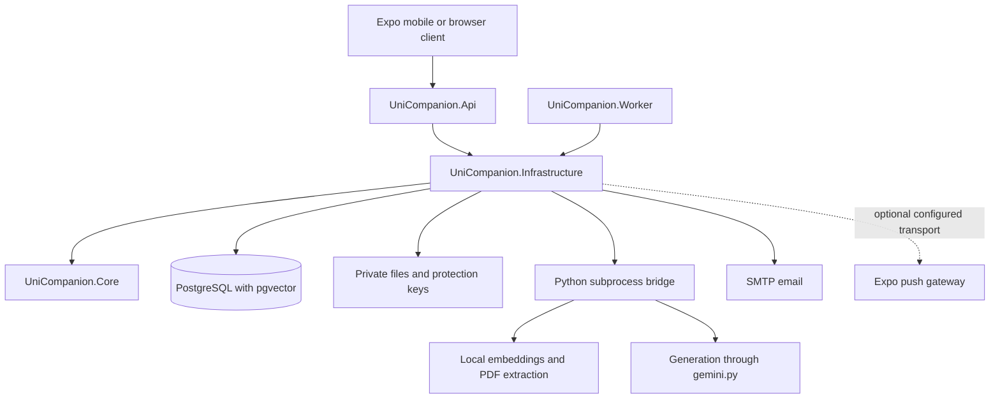

# Learning C# and .NET through Uni Companion

This guide explains the backend in this repository for an experienced Java developer. It also compares the design with Spring Boot and Python/FastAPI. Read it alongside the linked source files: the examples become much easier when you can follow a real request.

Inspected on 24 October 2026. This describes the current working tree, including local, uncommitted phone-push preparation. It explains implementation, not a claim that every feature has passed production or physical-phone acceptance. No services were started to write this guide.

## Contents

1. [Translate the ecosystem](#1-translate-the-ecosystem)
2. [Understand the architecture](#2-understand-the-architecture)
3. [Navigate the folders](#3-navigate-the-folders)
4. [Read the C# syntax](#4-read-the-c-syntax-you-will-encounter)
5. [Follow application startup](#5-follow-application-startup)
6. [Understand dependency injection](#6-understand-dependency-injection)
7. [Follow an HTTP request](#7-follow-an-http-request)
8. [Understand persistence and migrations](#8-understand-persistence-and-migrations)
9. [Understand authentication and authorization](#9-understand-authentication-and-authorization)
10. [Understand the courses and files](#10-understand-the-courses-and-files)
11. [Follow an AI study job](#11-follow-an-ai-study-job)
12. [Understand retrieval and the Python boundary](#12-understand-retrieval-and-the-python-boundary)
13. [Understand practice, tutor, and learning](#13-understand-practice-tutor-and-learning)
14. [Understand community and notifications](#14-understand-community-and-notifications)
15. [Understand tests and local tooling](#15-understand-tests-and-local-tooling)
16. [Recognize the design tradeoffs](#16-recognize-the-design-tradeoffs)
17. [Study this project in a useful order](#17-study-this-project-in-a-useful-order)
18. [Official references](#18-official-references)

## 1. Translate the ecosystem

C# is the language. .NET supplies the runtime, standard libraries, SDK, and tooling. ASP.NET Core supplies the HTTP application framework. Entity Framework Core supplies the ORM. These are related pieces, not interchangeable names.

| In this backend | Closest Java/Spring concept | Python/FastAPI comparison |
| --- | --- | --- |
| C# | Java | Python language |
| .NET runtime / CLR | JVM | Python interpreter, with a different compilation model |
| .NET SDK / `dotnet` | JDK plus build tooling | Interpreter plus packaging/build tools |
| ASP.NET Core | Spring Web plus application hosting infrastructure | FastAPI/Starlette plus hosting integration |
| Kestrel | Embedded HTTP server such as Tomcat or Netty | Uvicorn is the closer server analogy |
| `.sln` | Workspace aggregating Maven/Gradle modules | Workspace grouping packages |
| `.csproj` | A Maven module's `pom.xml` / Gradle build file | Package/build metadata, roughly `pyproject.toml` |
| NuGet | Maven Central/package ecosystem | PyPI/package ecosystem |
| `ProjectReference` | Dependency on another local module | Dependency on another local package |
| Built-in DI container | Spring application context | `Depends` plus application-owned resources; different mechanics |
| Minimal API endpoint | Functional route or controller action | `@router.get(...)` / `@router.post(...)` |
| EF Core | Hibernate/JPA | SQLAlchemy |
| Npgsql | PostgreSQL JDBC driver and Hibernate dialect integration | PostgreSQL driver and SQLAlchemy dialect |
| EF migrations | Flyway/Liquibase-style schema evolution | Alembic |
| ASP.NET Core Identity | Account management plus security components | Usually assembled from several packages/services |
| `BackgroundService` | Managed long-running worker component | Managed async worker loop; deployment is your choice |
| xUnit | JUnit | pytest/unittest |

These are conceptual comparisons, not exact substitutions. For example, Spring Security and ASP.NET Core Identity divide responsibilities differently.

The project targets `net10.0`. [global.json](../../backend/global.json) selects SDK `10.0.402` with patch roll-forward. [Directory.Build.props](../../backend/Directory.Build.props) enables nullable analysis, implicit common imports, warnings as errors, and dependency lockfiles across the backend projects. These are the checked-in settings, not a recommendation to always use these versions in unrelated projects.

Normal builds produce .NET assemblies containing intermediate language, which the runtime ordinarily JIT-compiles. This is broadly familiar from Java bytecode and the JVM. This repository does not configure Native AOT publishing.

## 2. Understand the architecture

The useful description is a **layered backend with feature-based endpoint groups and a separate worker process**. It has a shared database and shared application code. It is not a collection of independently owned microservices.



The arrows above show a mixture of compile-time references and runtime calls. The precise project-reference graph is:

```text
Api ------------> Infrastructure ----------> Core
Worker ---------> Infrastructure ----------> Core
IntegrationTests -> Api (and its referenced projects)
```

`Core` has plain models and selected contracts, without EF Core or ASP.NET package references. `Infrastructure` contains persistence, external integrations, and much of the application/use-case logic. `Api` hosts HTTP endpoints. `Worker` hosts independent background loops.

This borrows ideas from Clean Architecture, but it is not a strict implementation of it: there is no separate Application project, API handlers sometimes use `AppDbContext` directly, and application workflows live inside Infrastructure. Understanding that actual dependency graph matters more than applying an architectural label.

Java analogy: imagine a multi-module project with `domain`, `infrastructure`, `web-app`, and `worker-app`. Both executable applications reuse the infrastructure module. FastAPI analogy: `domain/`, `services/`, `db/`, and `routers/`, with a second executable for background processing.

## 3. Navigate the folders

```text
backend/
├── UniCompanion.sln                    Solution grouping .NET projects
├── Directory.Build.props              Shared compilation/build policy
├── global.json                        SDK selection
├── compose.yaml                       Local PostgreSQL/pgvector and Mailpit
├── scripts/dev.py                     Local setup/run/migration/test commands
├── ai/
│   ├── bridge.py                      Private JSON input/output protocol
│   ├── gemini.py                      Existing generation adapter
│   ├── embeddings.py                  Multilingual query/document embeddings
│   └── extraction.py                  PDF text extraction and chunking
├── src/
│   ├── UniCompanion.Core/
│   │   ├── Courses/                   Course, membership, material, version
│   │   ├── Study/                     Jobs, requests, results, chunks, contracts
│   │   ├── Community/                 Posts, votes, related account features
│   │   ├── Activity/                  Events, inbox items, preferences
│   │   ├── Practice/                  Generated tasks, progress, attempts
│   │   ├── Tutor/                     Conversations and ordered turns
│   │   ├── Learning/                  Revision entries and reminder state
│   │   └── Push/                      Device/delivery models and gateway contract
│   ├── UniCompanion.Infrastructure/
│   │   ├── DependencyInjection.cs     Shared service registrations
│   │   ├── Persistence/               AppDbContext and design-time factory
│   │   ├── Migrations/                Schema changes and model snapshot
│   │   ├── Identity/                  AppUser, sign-in rules, SMTP email
│   │   ├── Storage/                   Private content-addressed file storage
│   │   ├── Courses/                   Catalogue importer
│   │   ├── Ai/                        Python bridge, indexing, retrieval, evaluation
│   │   ├── Study/                     Admission, generation, job processing, access
│   │   ├── Practice/                  Practice composer and evaluator
│   │   ├── Tutor/                     Conversation operations
│   │   ├── Community/                 Development sample seeding
│   │   ├── Activity/                  Outbox creation, dispatch, visibility
│   │   ├── Learning/                  Progress calculation and reminder dispatch
│   │   └── Push/                      Registration, gateway, durable delivery
│   ├── UniCompanion.Api/
│   │   ├── Program.cs                 HTTP host, middleware, route registration
│   │   ├── SafeExceptionHandler.cs    Safe error responses
│   │   ├── AdminBootstrap.cs          Explicit administrator setup command
│   │   ├── appsettings*.json          Non-secret application defaults
│   │   └── Features/                  Accounts, Courses, Study, Community,
│   │                                  Activity, Practice, Tutor, Learning, Push
│   └── UniCompanion.Worker/
│       └── Program.cs                 Study, activity, reminder, push loops
└── tests/
    ├── UniCompanion.IntegrationTests/  HTTP/database/security/workflow tests
    ├── python/                        Chunking and bridge contract checks
    ├── retrieval-evaluation.json       Retrieval/study evaluation cases
    └── practice-evaluation.json        Practice quality evaluation cases
```

`bin/` contains build outputs, like Maven's `target/`. `obj/` contains intermediate build/restore artifacts. `packages.lock.json` locks NuGet resolution; it does not contain application code. `.local/` contains ignored local runtime data/evidence, while `.env` supplies private local configuration. These should not be studied or committed as source code.

A namespace such as `UniCompanion.Infrastructure.Study` is comparable to a Java package. The folder usually mirrors it, but C# does not require the filesystem/package correspondence that Java tooling commonly expects. One C# file can contain multiple public types; this project does that frequently.

## 4. Read the C# syntax you will encounter

### Properties and initialization

From [Course.cs](../../backend/src/UniCompanion.Core/Courses/Course.cs):

```csharp
public sealed class Course
{
    public Guid Id { get; set; } = Guid.NewGuid();
    public string Title { get; set; } = "";
    public string? Description { get; set; }
}
```

`sealed` is like Java `final` on a class. `{ get; set; }` creates a property with compiler-generated accessors and storage. Callers use `course.Title`, while the language still gives it property semantics. `Guid` is comparable to `UUID`. `string?` permits null according to nullable reference analysis. `DateTimeOffset`, used elsewhere, represents a date/time with a UTC offset and is closer to Java `OffsetDateTime` than `LocalDateTime`.

`new Course { Title = request.Title.Trim() }` is an object initializer: construct the object, then assign the listed properties. `var` is compile-time type inference, not Python-style dynamic typing.

Nullable reference types are compiler analysis, not automatic runtime validation. `value!` suppresses a possible-null warning; it does not check the value or prevent `NullReferenceException`.

### Records and primary constructors

```csharp
public sealed record CreateCourse(string Title, string? Description);

public sealed class CourseSearch(AppDbContext db, IQueryEmbedding embeddings)
{
    // Methods can use db and embeddings.
}
```

A positional record is useful for request/response data, much like a Java record. Record classes have value-oriented equality and support `with` copies. Their referenced members can still be mutable, so a record is not a guarantee of deep immutability.

The class declaration above uses a primary constructor. It is constructor syntax, not an annotation or an instruction to create database fields. DI passes the declared dependencies when constructing the service. It is conceptually familiar from constructor injection in Spring.

### Extension methods, lambdas, and patterns

```csharp
public static IServiceCollection AddInfrastructure(
    this IServiceCollection services, IConfiguration config)
```

The `this` on the first argument makes this an extension method. It allows `builder.Services.AddInfrastructure(config)` even though we do not own `IServiceCollection`. It remains a static method; it does not change the target type at runtime.

`c => c.Title` is a lambda, similar to Java `c -> c.getTitle()`. `=>` also introduces expression-bodied methods/properties. `state is Queued or Running or Retry` is pattern matching. `value is { } present` can bind a non-null value. `[]` is a collection expression whose concrete type comes from context.

### Async, cancellation, and resource ownership

```csharp
public async Task<IReadOnlyList<SearchHit>> SearchAsync(
    Guid courseId, string userId, bool isAdmin,
    string question, CancellationToken ct)
```

`Task<T>` represents asynchronous completion with a result. `await` lets the method suspend while asynchronous work completes. Python's `async`/`await` looks similar; Java developers may think of futures or reactive composition, though the runtime models differ. ASP.NET Core ordinarily resumes work on thread-pool threads rather than a single Python-style event loop. Async does not automatically make CPU work parallel.

`CancellationToken` carries cooperative cancellation through DB, HTTP, file, and AI calls. Request handlers can receive the request cancellation token automatically. Workers receive a shutdown token. A cancellation request only helps if downstream code observes it.

`using var` resembles try-with-resources and calls `Dispose`. `await using` calls asynchronous disposal. In Python, compare `with` and `async with`. Read these scopes carefully around transactions and file handles.

## 5. Follow application startup

Start with [API Program.cs](../../backend/src/UniCompanion.Api/Program.cs).

```csharp
var builder = WebApplication.CreateBuilder(args);
builder.Services.AddInfrastructure(builder.Configuration);
var app = builder.Build();
// Middleware and endpoint registration follow.
await app.RunAsync();
```

The builder assembles configuration, logging, hosting, and services. `Build()` constructs the application. Middleware determines how requests pass through shared behavior; endpoint mappings determine which handler answers each route. `RunAsync()` starts the host and waits for shutdown. Top-level statements are why there is no handwritten `public static void Main`.

Compare this with `SpringApplication.run(...)` plus configuration classes, or creating a `FastAPI()` app and registering routers/middleware. The .NET configuration is explicit method calls rather than Spring component scanning.

The actual middleware includes:

1. Exception handling and status-code responses.
2. HTTPS redirection outside Development/Testing.
3. Authentication.
4. Custom request ID, `no-store`, browser-origin, and current-account/security-stamp checks.
5. Authorization.
6. Rate limiting.
7. Mapped endpoints.

Order matters: user-based limits need authentication to have established the principal. Authentication asks who the caller is; authorization asks whether that caller may perform an operation.

Startup also configures JSON to reject unmapped input members, validation services, a 1 MiB request-body limit, and account/community rate policies. Validation is a combination of framework binding/validation and explicit checks in endpoints/services; a C# type alone does not enforce all product rules.

Development exposes an OpenAPI document. `/health/live` answers whether the process is alive; `/health/ready` tests DB connectivity. Neither proves the AI provider, SMTP, or optional push gateway works.

Before starting HTTP, `Program.cs` recognizes explicit command modes such as `--migrate`, `--import`, `--index`, evaluation commands, `--seed-community`, and `--bootstrap-admin`. These build a service scope, run a task, and exit. Migrations are therefore an explicit command here, rather than an unconditional migration on every HTTP startup.

## 6. Understand dependency injection

[DependencyInjection.cs](../../backend/src/UniCompanion.Infrastructure/DependencyInjection.cs) is the shared composition code for API and worker.

```csharp
services.AddDbContext<AppDbContext>(options => options.UseNpgsql(connection));
services.AddScoped<StudyJobs>();
services.AddSingleton<PythonAiBridge>();
services.AddSingleton<ITextGeneration>(sp =>
    sp.GetRequiredService<PythonAiBridge>());
```

Registering a service tells the container how to create and reuse it. A handler declaring `StudyJobs jobs` receives a resolved instance rather than constructing one manually.

| Lifetime | Meaning | Usage here |
| --- | --- | --- |
| Singleton | One instance per container/process | Python bridge, file store, system clock |
| Scoped | One instance per explicit scope; normally one HTTP request | DbContext and many workflow services |
| Transient | A new instance per resolution | Available mechanism; not the main registration style here |

The worker and API are separate processes, so their singletons are separate objects. The bridge's in-process semaphore alone would not coordinate the two processes; its host file lock supplies another level of coordination.

Spring beans default to singleton scope. In this project, many services are deliberately scoped because they depend on the scoped DbContext. Do not inject a scoped DbContext into a long-lived singleton. See the official [ASP.NET DI guide](https://learn.microsoft.com/en-us/aspnet/core/fundamentals/dependency-injection?view=aspnetcore-10.0) and [Spring bean scopes](https://docs.spring.io/spring-framework/reference/core/beans/factory-scopes.html).

The worker uses `IServiceScopeFactory.CreateAsyncScope()` per iteration. This gives each unit of work a fresh context and disposes it afterward. That is similar to creating an independent SQLAlchemy session for a task. A background loop has no automatic HTTP request scope.

Interfaces are used at useful substitution points, including `ITextGeneration`, `IQueryEmbedding`, `IAccountEmail`, and `IPushGateway`. The project does not create an interface for every service. This keeps the code smaller while allowing tests to replace external integrations.

## 7. Follow an HTTP request

Open [CourseEndpoints.cs](../../backend/src/UniCompanion.Api/Features/Courses/CourseEndpoints.cs). A static `MapCourses` extension groups the routes:

```csharp
var courses = endpoints.MapGroup("/api/v1/courses")
    .WithTags("Courses")
    .RequireAuthorization();
```

This is comparable to a Spring controller base path or a FastAPI `APIRouter` prefix with shared security requirements. Minimal APIs are an alternative HTTP programming style within ASP.NET Core; this application does not use controller classes for these routes. See [Microsoft's Minimal APIs reference](https://learn.microsoft.com/en-us/aspnet/core/fundamentals/minimal-apis?view=aspnetcore-10.0).

Here is a shortened version of the actual course-creation handler:

```csharp
courses.MapPost("/", async (
    CreateCourse request, HttpContext context,
    AppDbContext db, CancellationToken ct) =>
{
    var userId = context.User.FindFirstValue(ClaimTypes.NameIdentifier)!;
    var course = new Course
    {
        Title = request.Title.Trim(),
        Description = request.Description,
        CreatorId = userId
    };
    db.Courses.Add(course);
    db.CourseMemberships.Add(new CourseMembership
    {
        CourseId = course.Id,
        UserId = userId
    });
    await db.SaveChangesAsync(ct);
    return Results.Created($"/api/v1/courses/{course.Id}",
        new { course.Id, course.Title });
});
```

The real handler also validates title/description length. Parameter binding supplies JSON as `CreateCourse`, the framework supplies `HttpContext` and cancellation, and DI supplies `AppDbContext`. Route values such as `{id:guid}` bind to `Guid id`; primitive parameters on GET routes commonly bind from route/query.

`new { ... }` creates an anonymous projection, often used here for JSON responses. `Results.Created`, `Ok`, `NotFound`, and `NoContent` construct HTTP results, similar to Spring `ResponseEntity` or FastAPI response/status helpers.

The current user ID comes from the authenticated principal, not a user ID supplied in JSON. Creating the course and its membership in one `SaveChangesAsync` gives a single transactional persistence operation with the relational provider.

The conceptual Spring equivalent would be `@PostMapping` receiving `@RequestBody`, `Authentication`, and a service/repository. FastAPI would receive a Pydantic request model, an authenticated-user dependency, and a DB-session dependency. The business operation is the same; parameter resolution and persistence APIs differ.

Errors are handled by [SafeExceptionHandler.cs](../../backend/src/UniCompanion.Api/SafeExceptionHandler.cs). Known study errors carry an HTTP status and stable code; unavailable AI maps to 503; unexpected failures map to 500. Responses include a request ID. Logging intentionally avoids dumping exception contents that could contain source text or provider URLs. Some endpoint validation errors are returned directly, so this project does not have one universal error envelope for every failure.

## 8. Understand persistence and migrations

[AppDbContext.cs](../../backend/src/UniCompanion.Infrastructure/Persistence/AppDbContext.cs) derives from `IdentityDbContext<AppUser>`. It combines our tables with Identity's account/role/token schema.

```csharp
public DbSet<Course> Courses => Set<Course>();
```

A `DbSet<T>` is a query/change entry point for an entity type. A `DbContext` tracks entities and coordinates persistence, closer to an EntityManager/Hibernate Session or SQLAlchemy Session than a JDBC connection. It is a short-lived unit of work, and it is not thread-safe. See [EF Core context lifetime](https://learn.microsoft.com/en-us/ef/core/dbcontext-configuration/).

### LINQ is sometimes a database query

```csharp
var titles = await db.Courses.AsNoTracking()
    .Where(c => c.IsCurated)
    .OrderBy(c => c.Title)
    .Select(c => c.Title)
    .ToListAsync(ct);
```

While this is `IQueryable`, EF builds an expression tree and translates supported operations to SQL. `ToListAsync` executes it. This is not the same as loading all rows and applying Java Streams. Once data is materialized as a list, LINQ operates in memory instead. Not every C# method can be translated into SQL.

`AsNoTracking()` avoids change tracking for read-only projections. For a tracked entity, assigning a property followed by `SaveChangesAsync` is enough to persist the change. `ExecuteUpdateAsync` writes directly in SQL without synchronizing already-tracked objects; mixing the two styles requires care.

### Mapping lives outside the models

`OnModelCreating` configures keys, lengths, relationships, indexes, check constraints, and column types through EF's fluent API. This is comparable to JPA annotations/XML mappings or SQLAlchemy table mapping, but our Core entities remain free of persistence annotations.

Important examples include composite course-membership keys, unique idempotency keys, unique conversation turn ordinals, foreign-key deletion rules, `jsonb` request/result columns, and a 384-element embedding size constraint. Embeddings are stored as PostgreSQL `real[]` and cast to `vector` in search SQL. Calling the setup simply a native vector column everywhere would be inaccurate.

### Transactions and raw SQL

`SaveChangesAsync` ordinarily wraps its own relational changes transactionally. Multi-step operations use explicit transactions:

```csharp
await using var tx = await db.Database.BeginTransactionAsync(ct);
// Several related database operations.
await db.SaveChangesAsync(ct);
await tx.CommitAsync(ct);
```

Compare with Spring's `@Transactional` or SQLAlchemy's `session.begin()`. Here the transaction boundary is visible in code rather than relying on annotation interception. Spring's default proxy-based transactions have their own behavior, including self-invocation limitations; see [Spring transactional methods](https://docs.spring.io/spring-framework/reference/data-access/transaction/declarative/annotations.html).

The project uses parameterized raw SQL where PostgreSQL features are useful: conflict-safe joins, queue claiming, advisory locks, full-text/vector retrieval, and transactional outbox writes. `ExecuteSqlInterpolatedAsync` parameterizes values; do not confuse it with constructing an arbitrary SQL string through concatenation. `CourseSearch` also uses explicit `NpgsqlCommand` parameters.

### Migrations

`Migrations/` records schema changes. The model snapshot represents EF's last migration model and helps generate subsequent differences. `DesignTimeDbContextFactory` lets EF tooling create a context outside normal application startup. Applying migrations changes the database; changing a C# property alone does not update an existing schema.

Use the repository's explicit migration command when intentionally resuming development. Migration files belong in source control; local database files and credentials do not.

## 9. Understand authentication and authorization

Read [AccountEndpoints.cs](../../backend/src/UniCompanion.Api/Features/Accounts/AccountEndpoints.cs), [BrowserSession.cs](../../backend/src/UniCompanion.Api/Features/Accounts/BrowserSession.cs), and [Identity/](../../backend/src/UniCompanion.Infrastructure/Identity).

Identity provides password handling, account persistence, roles, confirmation/reset token support, and sign-in utilities. `AppUser` extends its standard user model. `UserManager<AppUser>` manages account operations; the custom `ActiveSignInManager` applies additional account eligibility rules.

Implemented account operations include registration, email confirmation/resend, login, refresh, forgot/reset/change password, profile read/update, and logout-all. Current settings require confirmed unique email, passwords of at least 12 characters, and lockout after five failed sign-ins for 15 minutes. SMTP delivery uses MailKit; local Mailpit captures development messages.

There are two session paths:

| Client | Mechanism | Important implementation detail |
| --- | --- | --- |
| Native mobile | Bearer access and refresh tokens | Access lifetime 5 minutes; refresh lifetime 14 days |
| Browser | `uni.session` HttpOnly cookie | Strict SameSite, Secure outside local overrides, sliding 14-day lifetime |

The bearer scheme uses ASP.NET Core Identity's protected opaque token format. **These are not JWTs.** A bearer token is a presentation method, not a promise of JWT encoding. Our account routes are custom handlers around Identity components; the application does not simply expose all default Identity endpoints. The [official Identity API explanation](https://learn.microsoft.com/en-us/aspnet/core/security/authentication/identity-api-authorization?view=aspnetcore-10.0) describes the cookie/token distinction.

Data Protection manages protection keys persisted under the configured private storage root. Losing or mismatching keys affects protected authentication material. A policy scheme chooses bearer authentication when the Authorization header contains a bearer token, otherwise browser-cookie authentication.

For authenticated requests, the API also checks the current security stamp and account eligibility. A security stamp is a changing account marker used to invalidate older credentials, for example after logout-all. This adds live account checks beyond just decoding a token.

Route authorization is only one layer. Services also check course membership, ownership, administrator roles, content visibility, and current account state. Knowing a material/job/attempt GUID does not grant permission to read it. Browser state-changing requests additionally undergo origin checks because cookies are attached automatically by the browser.

## 10. Understand the courses and files

The course catalogue distinguishes a course's metadata from permission to read its material. A preview can show what is available, while joining creates an explicit `CourseMembership`. The creator is automatically enrolled on course creation. Administrator recognition is a separate action.

`Course` describes the subject. `Material` describes a resource and points to its current version. `MaterialVersion` records content hash, byte length, and page information. Chapter information comes from imported metadata and material lesson IDs.

[CatalogueImporter.cs](../../backend/src/UniCompanion.Infrastructure/Courses/CatalogueImporter.cs) imports the prepared university catalogue. The backend does not scrape the university each time a student opens a course. `CorpusIndexer` indexes the private imported PDFs for retrieval.

[PrivateFileStore.cs](../../backend/src/UniCompanion.Infrastructure/Storage/PrivateFileStore.cs) stores files by SHA-256 hash. It checks the hash, copies through a temporary file, and places the result under a hash-derived path. This is content-addressed storage: identity follows the bytes rather than a user-controlled filename.

Downloads go through authenticated endpoints, which recheck access before serving a file. Range processing supports partial downloads/PDF readers. Version-specific file/page routes let citations refer to the document version used to generate an answer. Files are not exposed through an unrestricted static directory.

## 11. Follow an AI study job

The expensive generation workflow runs through durable database jobs. The HTTP request admits work; the separate worker completes it. Closing the mobile screen does not inherently cancel the saved job.

```mermaid
sequenceDiagram
    participant C as Client
    participant A as API
    participant D as PostgreSQL
    participant W as Worker
    participant P as Python bridge
    C->>A: Study request + Idempotency-Key
    A->>D: Validate access, limits, sources; save queued job
    A-->>C: Job reference/status
    W->>D: Atomically claim job and lease
    W->>D: Read authorized source chunks
    W->>P: Generate from bounded evidence
    P-->>W: Provider response
    W->>W: Validate structure and citations
    W->>D: Publish result and activity event transactionally
    C->>A: Poll job status/result
    A->>D: Recheck owner and source access
    A-->>C: State, progress, permitted result
```

Read these files together:

| File | Responsibility |
| --- | --- |
| [StudyEndpoints.cs](../../backend/src/UniCompanion.Api/Features/Study/StudyEndpoints.cs) | HTTP creation/read/cancel/history/attempt routes |
| [StudyAccess.cs](../../backend/src/UniCompanion.Infrastructure/Study/StudyAccess.cs) | Current permission checks |
| [StudyJobs.cs](../../backend/src/UniCompanion.Infrastructure/Study/StudyJobs.cs) | Validation, admission, limits, idempotency, saved results/attempts |
| [StudyProcessor.cs](../../backend/src/UniCompanion.Infrastructure/Study/StudyProcessor.cs) | Claiming, leases, retry, cancellation, publication |
| [StudyComposer.cs](../../backend/src/UniCompanion.Infrastructure/Study/StudyComposer.cs) | Evidence selection, prompts, output parsing and validation |
| [Worker Program.cs](../../backend/src/UniCompanion.Worker/Program.cs) | Registers independent hosted services |
| [ScopedPollingWorker](../../backend/src/UniCompanion.Worker/Workers/ScopedPollingWorker.cs) | Async scopes, cancellation and polling lifecycle shared by the hosted loops |

### Idempotency, fingerprints, and limits

An `Idempotency-Key` identifies a logical submission. Repeating the same owner/key/payload resolves to the existing operation. Reusing the key with changed input returns a conflict. This protects against mobile retries and double taps. Database uniqueness plus transactional locking enforce the rule under concurrent requests.

A fingerprint additionally incorporates request/source versions and generation versions. Certain successful study outputs can be reused for the same owner; practice/tutor requests do not follow that same reuse path. Source-version pinning prevents an in-flight request from silently switching to newly imported bytes. Stored results can be marked stale when source versions change.

Admission checks bound per-account and global work. Current code limits new jobs to five per minute and fifty per day per owner, two pending jobs per owner, and twenty pending globally. These values are prototype policy, not framework defaults.

### Worker reliability

Job states include `queued`, `running`, `retry_wait`, `succeeded`, `failed`, and `cancelled`.

`FOR UPDATE SKIP LOCKED` and an atomic update let workers claim eligible work without claiming the same row concurrently. The lease says who owns execution until a deadline. A heartbeat renews it. A fencing counter increments on each claim, so a worker whose lease expired cannot later publish over a replacement's result.

Retries distinguish temporary provider failures from permanent errors. There are limits on attempts, provider calls, and total job time; summary stages have saved checkpoints to avoid repeating completed stages. Current processing uses at most three attempts, twelve provider calls, and a ten-minute job budget. The study loop logs concurrency one; the AI bridge also constrains execution.

Publication rechecks permissions and uses transactional locking. A student losing course/account access during generation should not receive a newly published result based on obsolete permission. The heartbeat uses its own service scope/context so it does not concurrently use the processor's DbContext.

Durability comes from persisted state and claim/publication rules, not from inheriting `BackgroundService`. This is closer to a database-backed job runner than a fire-and-forget HTTP task. A separate worker must actually be running for queued generation to advance.

## 12. Understand retrieval and the Python boundary

### Retrieval-augmented generation

This application does not train a model on the university PDFs. It extracts and indexes them, retrieves relevant passages, and supplies those passages as generation evidence: retrieval-augmented generation, or RAG.

The indexing path is:

```text
Imported private PDF
  -> extraction of text with page information
  -> bounded chunks
  -> multilingual 384-dimensional embeddings
  -> DocumentChunks in PostgreSQL
```

[CourseSearch.cs](../../backend/src/UniCompanion.Infrastructure/Ai/CourseSearch.cs) combines English/French PostgreSQL full-text matching with semantic vector similarity. It merges ranks, diversifies by material version/page, and returns a bounded selection. Its SQL filters course membership and eligible versions before returning source evidence.

A vector is a numerical representation used for similarity. The configured model identifier is `sentence-transformers/paraphrase-multilingual-MiniLM-L12-v2@fastembed-0.9.0`. Stored model identity and vector-length checks prevent silently mixing incompatible embeddings.

Generation validates the returned JSON schema, permitted citation IDs, quotes, and bounds. For summaries, the composer can summarize groups and combine saved intermediate results. Quizzes get bounded options and explanations. Some evidence gaps lead to an insufficient-evidence response rather than invented coverage.

Citation validation confirms that referenced chunks/quotes belong to supplied evidence. It cannot mathematically prove that every natural-language conclusion follows from the quote. Quality evaluation remains necessary.

### Why Python exists here

[PythonAiBridge.cs](../../backend/src/UniCompanion.Infrastructure/Ai/PythonAiBridge.cs) implements the .NET embedding and generation contracts by starting a Python process. [bridge.py](../../backend/ai/bridge.py) accepts bounded JSON lines for `embed`, `index`, or `generate` operations. Generation calls the supplied `gemini.py` adapter.

This is **not a FastAPI service**. There is no AI HTTP router/port in this bridge. The transport is the child process's standard input/output:

```text
C# process -> JSON request on stdin -> Python
C# process <- JSON response on stdout <- Python
```

The C# side sets timeouts, bounds output, checks responses, drains diagnostic output, and kills the child process tree when needed. It launches the executable without a shell. A semaphore coordinates calls inside a process, while a file lease coordinates the local API/worker processes sharing the storage root. That local file lock is not a distributed cluster lock.

This arrangement reuses Python's PDF/embedding tools and the existing generation adapter while keeping accounts, permissions, persistence, and job orchestration in .NET. Its cost is subprocess/model startup overhead and deliberately limited local concurrency. Moving to an HTTP inference service later would require an intentional new operational boundary; it is not how this implementation currently works.

## 13. Understand practice, tutor, and learning

### Generated practice

[PracticeComposer.cs](../../backend/src/UniCompanion.Infrastructure/Practice/PracticeComposer.cs) builds source-grounded written exercises and Python standard-library coding labs. Requests support written, coding, and mixed modes, difficulty choices, and bounded session durations. Practice generation reuses the study queue and source access controls.

Practice has task statements, hints, solutions/rubrics, private progress, and saved attempts. Ordinary result projections omit hints and solutions until the owner explicitly reveals them. Attempt submission is bounded and idempotent. Student code is stored/reviewed as text; the backend does **not execute it**. There is no hidden sandbox or automatic compilation service.

### Saved tutor conversations

[TutorConversations.cs](../../backend/src/UniCompanion.Infrastructure/Tutor/TutorConversations.cs) manages course-scoped conversations and ordered turns. Explain, Hint, and Check reasoning use bounded recent conversation excerpts plus freshly authorized source retrieval. Each turn is backed by a study job, so it participates in the worker's limits and retry handling.

The implementation supports reopening, individual deletion, and clearing history. It bounds conversations to forty turns and serializes active replies rather than allowing turns to race. Saved-practice feedback can inspect submitted reasoning/code against the task/rubric without running it.

Feedback labels its basis: `saved_work` for analysis of the submission, `course_sources` for claims supported by course citations. This prevents a code-review observation from being falsely attributed to a PDF.

### Learning progress and revision

[LearningProgress.cs](../../backend/src/UniCompanion.Infrastructure/Learning/LearningProgress.cs) computes evidence from actual quiz submissions, practice attempts, revealed help, self-marked completion, and AI feedback. Those are different signals; a student's own completion check is not an externally verified grade.

The revision queue uses missed questions from the latest saved quiz attempt and concepts the student saves. Entries support topic labels, notes, snoozing, dismissal, and restoration. Correcting a question can remove that missed-question item. History/discussion search and reminders build on saved data, not an AI claim that the student has mastered a subject.

[RevisionReminders.cs](../../backend/src/UniCompanion.Infrastructure/Learning/RevisionReminders.cs) schedules opt-in reminders using the chosen timezone and quiet hours. Its worker creates Activity entries when due. Scheduling must handle local-time/daylight-saving transitions rather than simply adding 24 hours to every UTC timestamp.

## 14. Understand community and notifications

### Community

[CommunityEndpoints.cs](../../backend/src/UniCompanion.Api/Features/Community/CommunityEndpoints.cs) and [CommunityAccountEndpoints.cs](../../backend/src/UniCompanion.Api/Features/Community/CommunityAccountEndpoints.cs) handle threads, one-level replies, votes, owner edits/deletion, own-discussion lists, bookmarks, subscriptions, helpful replies, reporting, blocking, and administrator review.

The database retains ownership for anonymous content, while public projections hide it. Owners can privately find their own anonymous discussions. Named and anonymous identity modes are treated carefully in OP markers and blocking so the interface does not accidentally reveal a connection between identities. Deletion redacts content while preserving thread continuity.

That illustrates why response projections matter: a database entity can contain fields that must never be serialized directly to a public client.

### Transactional outbox and Activity

[ActivityEvents.cs](../../backend/src/UniCompanion.Infrastructure/Activity/ActivityEvents.cs) records an event in the same database transaction as the source change. It explicitly refuses to create these events without a current transaction.

Why? If a reply commits but event creation fails afterward, its notification can disappear. If notification happens first and the reply rolls back, users can be notified about nonexistent content. Saving source and event together makes them commit or roll back together.

[ActivityDispatcher.cs](../../backend/src/UniCompanion.Infrastructure/Activity/ActivityDispatcher.cs) claims undispatched events and creates owner-specific inbox rows. It rechecks account eligibility, preferences, subscriptions, blocks, and study access. Unique keys/upserts make repeated processing safe and allow grouped activity. Read/unread state and visibility are handled through the Activity endpoints/services.

This gives eventual consistency: a reply can be visible before its inbox notification appears. No Kafka or RabbitMQ is required for this implementation; PostgreSQL is the durable outbox store.

### Optional OS push

An Activity inbox entry and an Android/iOS system notification are separate things. Activity is stored in our database; OS push needs device registration plus an external delivery provider.

The current working tree contains preparation for installation proofs, protected Expo tokens, account/device binding, stale-update protection, durable delivery/receipt processing, and an Expo HTTP gateway. `PushConfiguration` requires both enablement and a valid project ID. Permission, preferences, quiet hours, current access, and device/account changes influence delivery.

That transport remains disabled/unconfigured in the inspected state. A real Expo/EAS project, Android FCM setup, an appropriate development build, and physical-device verification are still required for actual Android delivery. Scanning the normal Expo Go QR code is sufficient for core app development, not acceptance of this custom push setup. See [phone notification setup](phone-notifications.md).

## 15. Understand tests and local tooling

[ApiFixture.cs](../../backend/tests/UniCompanion.IntegrationTests/ApiFixture.cs) uses `WebApplicationFactory<Program>` to host the API for integration tests. It creates a temporary real PostgreSQL database, applies migrations, uses isolated file/key storage, and sends HTTP requests through the application's test host.

External boundaries are substituted: test email capture, fake embeddings, controlled generation, and a fake push gateway. This tests the HTTP/application/database path without making every test depend on live AI/SMTP/push availability. Real PostgreSQL matters because locks, `jsonb`, vector casts, constraints, and conflict syntax would not be faithfully tested by a simple in-memory store.

`public partial class Program;` at the end of API startup makes the generated entry-point type accessible to this test setup. Think of `@SpringBootTest` plus an HTTP test client and isolated DB, although the hosting mechanisms differ. FastAPI's dependency overrides and test clients provide similar boundary replacement ideas.

The suite covers accounts, browser sessions, access, courses, retrieval, study jobs, practice, tutor, community, Activity, learning, push, rate limits, and migrations. Python tests cover extraction/chunking and the generation adapter contract. Evaluation manifests additionally exercise retrieval/generation quality; a structurally valid JSON response is not by itself proof of educational quality.

These commands are documented for future study; none were executed to write this guide. Run from the repository root after completing the prerequisites in [backend README](../../backend/README.md):

```bash
# Local configuration and dependencies, when intentionally restarting development:
python3 backend/scripts/dev.py setup
python3 backend/scripts/dev.py up
python3 backend/scripts/dev.py migrate

# Separate terminals:
python3 backend/scripts/dev.py serve
python3 backend/scripts/dev.py worker

# Validation:
make backend-check
make backend-test

# Stop the project's local Docker services without deleting their data:
python3 backend/scripts/dev.py down
```

`serve` and `worker` are long-running processes; stop those terminals separately. `down` in this helper maps to Docker Compose **stop**, preserving the database volume. `backend-check` performs locked restore, formatting verification, build, and Python tests; `backend-test` runs the .NET tests using local configuration and requires PostgreSQL. Restore/build does not replace integration testing.

The development helper loads ignored local credentials and sets names such as `ConnectionStrings__Database`, `Storage__Root`, and `Ai__Python`. Double underscores map to hierarchical configuration keys, for example `ConnectionStrings:Database`. The host reads JSON defaults plus environment/other configuration providers; unlike Spring, these services use .NET's `IConfiguration` and options APIs.

Docker Compose starts PostgreSQL/pgvector and Mailpit here. The .NET API/worker and Python child process run on the host in the normal local workflow. Python's presence in the dev helper does not make Python the web backend.

## 16. Recognize the design tradeoffs

The design keeps infrastructure modest: one database, private local file storage, an HTTP host, and a worker host. Feature folders make routes discoverable; shared models/services let both hosts cooperate; durable jobs/outbox survive process interruption better than in-memory queues.

The cost is substantial PostgreSQL-specific orchestration and some large endpoint/service files. Infrastructure combines application and adapter responsibilities. Direct DbContext access in handlers favors straightforward implementation over strict dependency isolation. Shared local files, protection keys, AI locking, and low concurrency assume a particular deployment arrangement; adding replicas requires revisiting those assumptions.

There is no generic repository layer, no MediatR pipeline, no event-sourcing store, no distributed broker, no student-code execution sandbox, and no separate FastAPI inference server in the inspected implementation. You do not need to invent those components to understand the existing backend.

For a new feature, follow the established shape: model/contracts in Core as needed, mappings/migration when persistence changes, workflow/integration logic in Infrastructure, routes in the relevant API feature, worker participation if durable asynchronous work is needed, and tests at the meaningful boundaries. A separate Application layer could be a later refactoring decision, not a prerequisite to learning this code.

Common Java-to-.NET mistakes to avoid:

- Treating every service as a Spring-style default singleton despite holding a scoped DbContext.
- Treating `IQueryable` like an already-loaded Java collection.
- Running concurrent queries on the same DbContext.
- Assuming every bearer token is a JWT.
- Assuming nullable analysis performs runtime input validation.
- Blocking asynchronous I/O with `.Result`/`.Wait()` in request handling.
- Assuming a `BackgroundService` alone guarantees durable/exactly-once execution.
- Assuming generated citations prove semantic correctness or AI feedback proves executed code passed.

For FastAPI, the closest async comparison is the use of awaited I/O, while dependency lifetime and server scheduling differ. FastAPI's built-in background tasks run in the application process and are not a durable queue replacement. Our independent worker/database protocol exists to provide persisted scheduling and recovery. See the official [FastAPI concurrency guide](https://fastapi.tiangolo.com/async/) and [background-task guide](https://fastapi.tiangolo.com/tutorial/background-tasks/).

## 17. Study this project in a useful order

1. **C# basics through Core:** read `Course.cs` and `StudyJob.cs`. Translate properties, records, nullability, pattern matching, and async contracts into Java concepts.
2. **One HTTP feature:** read API `Program.cs`, then `CourseEndpoints.cs`. Trace course creation and joining before tackling AI.
3. **DI and persistence:** read `DependencyInjection.cs` and `AppDbContext.cs`. Follow a LINQ query and a tracked update; inspect a migration.
4. **Accounts:** follow register → email confirmation → login → authenticated `/me`. Compare the principal/security-stamp checks with Spring Security concepts.
5. **Durable work:** follow `StudyEndpoints` → `StudyJobs` → Worker → `StudyProcessor` → `StudyComposer`. Draw the states and identify every transaction boundary.
6. **AI integration:** read `CourseSearch`, `PythonAiBridge`, and `ai/bridge.py`. Separate retrieval, orchestration, transport, and generation responsibilities.
7. **Events:** trace a community reply through its transaction, Activity event, dispatcher, and inbox item. Explain what happens if the worker stops after each step.
8. **Tests:** read `ApiFixture`, then one course test and one study test. Identify which dependencies remain real and which are substituted.

For practice, first explain an existing endpoint in your own words without changing it. Then, in your own development session, implement a small authenticated feature using the existing structure. A course update or filtered listing exercises routing, validation, authorization, LINQ, and persistence before you need to modify the queue machinery.

Questions you should eventually be able to answer:

- Why can a student preview a course but still be unable to download its PDF?
- Which service instances are shared within one HTTP request, and which survive across requests?
- What happens if the same mobile submission is retried with the same key but different content?
- Why does the heartbeat create its own DbContext?
- What prevents an expired worker from publishing an obsolete result?
- Why is an Activity event saved inside the reply transaction?
- What parts of an AI response can the backend validate mechanically, and what still needs quality evaluation?
- Which pieces would need to change before running the API and worker on different machines?

## 18. Official references

The linked source files are the authority for what this project actually does. The following primary documentation supports the framework comparisons and provides deeper study:

- [ASP.NET Core Minimal APIs](https://learn.microsoft.com/en-us/aspnet/core/fundamentals/minimal-apis?view=aspnetcore-10.0)
- [ASP.NET Core dependency injection](https://learn.microsoft.com/en-us/aspnet/core/fundamentals/dependency-injection?view=aspnetcore-10.0)
- [EF Core DbContext configuration and lifetime](https://learn.microsoft.com/en-us/ef/core/dbcontext-configuration/)
- [Identity for API backends, including cookie and token options](https://learn.microsoft.com/en-us/aspnet/core/security/authentication/identity-api-authorization?view=aspnetcore-10.0)
- [Spring bean scopes](https://docs.spring.io/spring-framework/reference/core/beans/factory-scopes.html)
- [Spring declarative transaction annotations](https://docs.spring.io/spring-framework/reference/data-access/transaction/declarative/annotations.html)
- [FastAPI async/concurrency](https://fastapi.tiangolo.com/async/)
- [FastAPI background tasks](https://fastapi.tiangolo.com/tutorial/background-tasks/)
